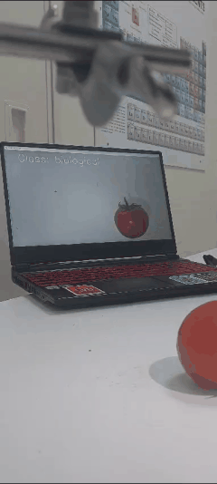
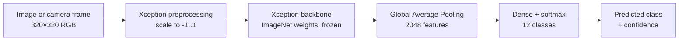
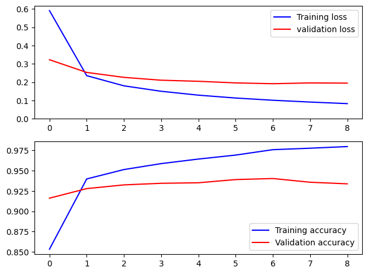
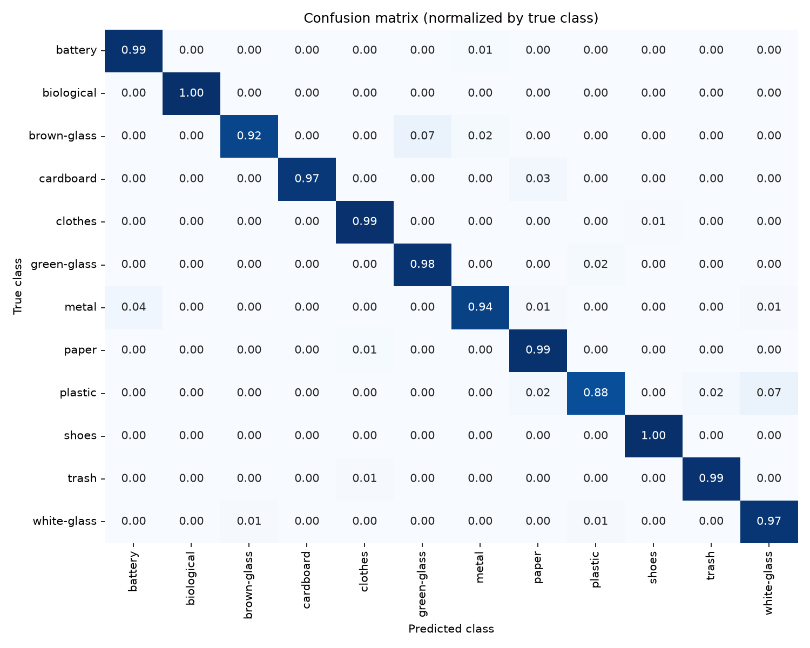

# Waste Classification with Transfer Learning (Xception)

**Classify waste images into 12 categories with a fine-tuned Xception CNN, from a desktop app or a live camera feed. 95.8% accuracy on the test set.**


<p align="center">
  
  <br><em>Live demo: a phone camera streams to the laptop, which classifies each frame in real time (video sped up ×4).</em>
</p>

## Overview

Sorting waste at the source is a prerequisite for recycling, but it is error-prone when done by hand. This project builds an image classifier that recognizes **12 waste categories** (battery, biological, brown glass, cardboard, clothes, green glass, metal, paper, plastic, shoes, trash, white glass) and wraps it in a simple desktop application with **real-time camera detection**.

- **Context:** computer science project at EMINES – UM6P (February – June 2024), carried out by a team of two.
- **My role:** co-developed the whole pipeline with my teammate: data preparation, transfer-learning model and training, evaluation, the Tkinter desktop app and real-time detection from a phone camera.

## Method



- **Transfer learning:** the Xception network pre-trained on ImageNet is used as a frozen feature extractor. Only the final dense layer is trained (**24,588 trainable parameters** out of 20.9 M), which makes training fast and robust on a dataset of ~15.5k images.
- **Data:** [Garbage Classification (12 classes)](https://www.kaggle.com/datasets/mostafaabla/garbage-classification), 15,515 images, split **80% train / 10% validation / 10% test**. The dataset is imbalanced (5,325 images of clothes vs. ~600 of brown glass), see [results/class_distribution.png](results/class_distribution.png).
- **Training:** Adam optimizer, categorical cross-entropy, batch size 64, data augmentation (rotations, shear, zoom, flips, shifts), early stopping on validation accuracy (patience 2, best weights restored).
- **Inference:** a Tkinter desktop app (upload an image) and an OpenCV loop that classifies frames from a webcam or a phone camera streamed over Wi-Fi (Android *IP Webcam* app).

## Results

Test set: 1,552 images never seen during training ([classification report](results/classification_report_training_run.txt), [training history](results/training_history.csv)). The full analysis is in the [notebook](notebooks/waste_classification.ipynb).

| Metric | Value |
|---|---|
| **Test accuracy** | **95.81%** |
| Macro-averaged F1 | 0.93 |
| Weighted F1 | 0.96 |
| Best validation accuracy | 94.01% (epoch 7, early stopping at epoch 9) |

<details>
<summary>Per-class results</summary>

| Class | Precision | Recall | F1 | Support |
|---|---|---|---|---|
| battery | 0.92 | 0.99 | 0.95 | 77 |
| biological | 0.99 | 1.00 | 1.00 | 107 |
| brown-glass | 0.91 | 0.88 | 0.89 | 58 |
| cardboard | 0.97 | 0.93 | 0.95 | 91 |
| clothes | 1.00 | 0.99 | 0.99 | 567 |
| green-glass | 0.94 | 0.87 | 0.90 | 53 |
| metal | 0.87 | 0.87 | 0.87 | 83 |
| paper | 0.92 | 0.97 | 0.94 | 102 |
| plastic | 0.89 | 0.84 | 0.86 | 76 |
| shoes | 0.98 | 1.00 | 0.99 | 189 |
| trash | 1.00 | 0.96 | 0.98 | 78 |
| white-glass | 0.82 | 0.86 | 0.84 | 71 |

</details>

The weakest classes are **white glass, plastic and metal**: transparent and reflective materials whose appearance depends strongly on lighting and background. Because *clothes* makes up a third of the data, the macro F1 (0.93) is a more honest summary than accuracy.

<p align="center">
  
  
</p>

The confusion matrix (right) was computed after the project with `python -m src.evaluate`, on a seeded, stratified split that does not match the original random split exactly, so part of its test images were seen during training (97.9% accuracy on that split, [report](results/classification_report.txt)). It is shown to illustrate the error patterns: **plastic → white glass**, **brown glass → green glass** and **metal → battery** are the most frequent confusions.

## Tech stack

- **Deep learning:** TensorFlow 2.17 / Keras 3, Xception (ImageNet)
- **Computer vision:** OpenCV (camera capture, display), Pillow
- **Data & evaluation:** pandas, scikit-learn, matplotlib, seaborn
- **GUI:** Tkinter

## Project structure

```
waste-classification-xception/
├── src/
│   ├── config.py       # paths, image size, class names, camera source
│   ├── model.py        # Xception transfer-learning model, loading, prediction
│   ├── data.py         # dataset listing, stratified 80/10/10 split, generators
│   ├── train.py        # training + training curves
│   ├── evaluate.py     # test accuracy, classification report, confusion matrix
│   ├── predict.py      # classify image files from the command line
│   ├── realtime.py     # live classification from a webcam / IP camera
│   ├── app.py          # Tkinter desktop app
│   └── assets/         # GUI images
├── notebooks/
│   └── waste_classification.ipynb   # dataset, results, confusion matrix, error analysis
├── data/
│   ├── README.md       # dataset download instructions
│   └── samples/        # a few test images
├── models/README.md    # trained model download link
├── results/            # training curves, confusion matrix, classification reports
└── media/demo.gif
```

## Getting started

```bash
git clone https://github.com/ahmedlebbar/waste-classification-xception.git
cd waste-classification-xception
python -m venv .venv
.venv\Scripts\activate          # Windows  (Linux/macOS: source .venv/bin/activate)
pip install -r requirements.txt

# Download the trained model (~84 MB)
curl -L -o models/model.h5 https://github.com/ahmedlebbar/waste-classification-xception/releases/download/v1.0/model.h5
```

| Task | Command |
|---|---|
| Classify images | `python -m src.predict data/samples/*.jpg` |
| Desktop app | `python -m src.app` |
| Live detection (webcam) | `python -m src.realtime` |
| Live detection (phone) | `python -m src.realtime --source http://<phone-ip>:8080/video` |
| Train | `python -m src.train` (dataset required, see [data/README.md](data/README.md)) |
| Evaluate | `python -m src.evaluate` |

## Team & acknowledgments

- Team: **Ahmed Lebbar** and **Ayman Knadel**.
- Dataset: [Garbage Classification (12 classes)](https://www.kaggle.com/datasets/mostafaabla/garbage-classification) by Mostafa Mohamed (Kaggle).
- Xception: F. Chollet, *Xception: Deep Learning with Depthwise Separable Convolutions*, CVPR 2017.

## Contact

**Ahmed Lebbar**, engineering student at EMINES – UM6P · [LinkedIn](https://www.linkedin.com/in/ahmed-lebbar/)

## License

[MIT](LICENSE)
